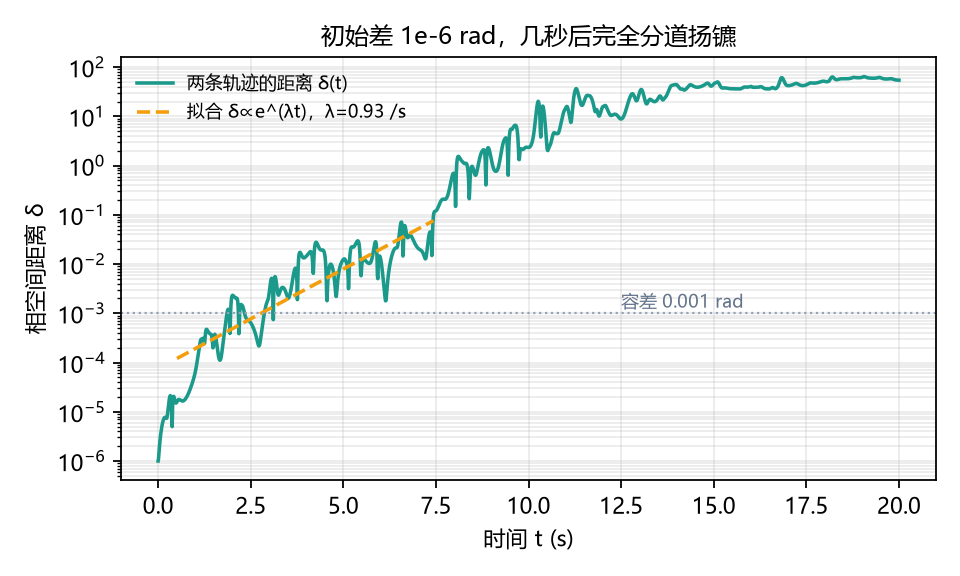
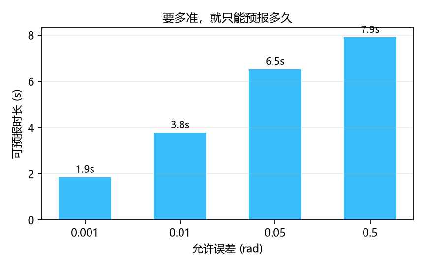
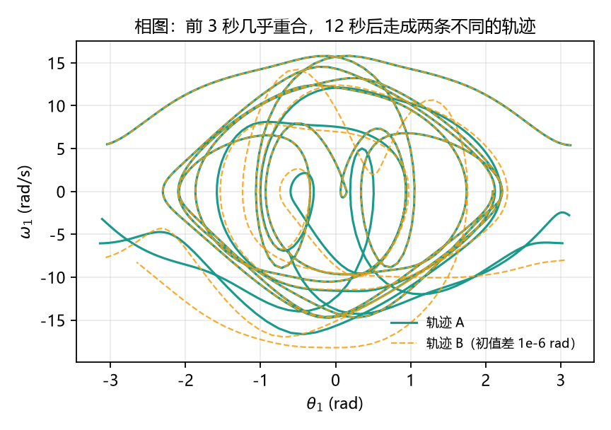

# 双摆为什么测不准：用一块单片机算出混沌的上限

**学段**：初中 9 年级 / 高一　**课时**：3 课时　**主控**：行空板 K10
**学科**：物理（非线性振动）+ 数学（微分方程、指数拟合）+ 信息科技（数值积分）

---

## 一、一个能被“算出来”的哲学问题

天气预报为什么只能报一周？三体问题为什么没有解析解？蝴蝶效应到底有多快？

这些问题指向同一件事：**混沌**——确定性系统对初值极端敏感。

双摆是最好的教具：两根杆、一个支点，方程完全确定，没有随机，没有摩擦。
但只要初始角度差 **百万分之一弧度**（约 0.00006°），两条轨迹几秒后就会彻底分开。

本项目让学生亲手量出这个“几秒”到底是几秒。

---

## 二、原理

### 2.1 运动方程

双摆没有解析解，只能用数值方法积分。状态为 $(θ_1, ω_1, θ_2, ω_2)$，方程：

```
θ̈₁ = [−g(2m₁+m₂)sinθ₁ − m₂g sin(θ₁−2θ₂) − 2sin(θ₁−θ₂)m₂(ω₂²L₂ + ω₁²L₁cos(θ₁−θ₂))]
      / [L₁(2m₁+m₂−m₂cos(2θ₁−2θ₂))]

θ̈₂ = [2sin(θ₁−θ₂)(ω₁²L₁(m₁+m₂) + g(m₁+m₂)cosθ₁ + ω₂²L₂m₂cos(θ₁−θ₂))]
      / [L₂(2m₁+m₂−m₂cos(2θ₁−2θ₂))]
```

### 2.2 李雅普诺夫指数

两条轨迹的距离 δ(t) 在混沌区按指数增长：

```
δ(t) ≈ δ₀ · e^(λt)
```

λ 就是**李雅普诺夫指数**，单位 1/s。它决定了系统的可预报上限：

```
T_pred ≈ (1/λ) · ln(Δ/δ₀)
```

Δ 是你能容忍的误差。**λ 越大，能预报的时间越短。**

---

## 三、实验一：分离曲线

初值：θ₁ = 120°、θ₂ = 90°，两条轨迹只差 δ₀ = 1×10⁻⁶ rad。

| 量 | 结果 |
|---|---|
| 拟合区间 | 0.5 – 7.4 s |
| **λ** | **0.93 /s** |
| 初始距离 | 1×10⁻⁶ |
| 7 秒后距离 | ≈ 0.6（放大了 60 万倍） |



半对数坐标下是一条直线——这就是“指数增长”的直接证据。

---

## 四、实验二：可预报时长

把“允许误差”设为不同值，看轨迹多久后超出：

| 允许误差 (rad) | 可预报时长 (s) |
|---:|---:|
| 0.001 | 1.9 |
| 0.01 | 3.8 |
| 0.05 | 6.5 |
| 0.5 | 7.9 |



两个结论：

1. **精度提高 10 倍，预报只多约 2.5 秒**——这是指数规律的直接后果（ln10/λ ≈ 2.5 s）；
2. 误差大到 0.5 rad 后不再增长，因为相空间本身有界，两条轨迹最终都跑遍整个吸引域。

---

## 五、实验三：相图



前 3 秒两条曲线几乎完全重合，画在一起看不出区别；12 秒后已经走成两条完全不同的路径。

**这就是“测不准”的几何图像**：不是我们量得不够准，是指数放大让任何有限精度都失效。

---

## 六、K10 端

`02_代码/K10端/main_chaos.cpp`：在板子上同时积分两个双摆。

| 模块 | 做法 |
|---|---|
| 积分 | RK4，200 Hz，误差 ~1e-9/步 |
| 显示 | 相图（θ₁–ω₁）增量绘制，只画新线段，避免重绘卡顿 |
| λ 估计 | 对 ln δ 做滑动最小二乘（40 点，每 50 ms 采一个） |
| 记录 | CSV 写 TF 卡，5 个样本一行 |
| 交互 | A 重置；B 切换初值差 1e-6 / 1e-3 / 1e-1 |

屏幕实时显示 λ、δ、t，学生能看到 λ 从抖动逐渐收敛到 0.9 左右。

---

## 七、三课时安排

| 课时 | 内容 |
|---|---|
| 1 | 现象：两个几乎一样的摆，为什么几秒后完全不同？（演示 + 猜想） |
| 2 | 测量：用 K10 跑两组初值，导出 CSV，画半对数图，拟合 λ |
| 3 | 推论：由 λ 算可预报时长；讨论三体、天气、台球为什么都测不准 |

---

## 八、可以继续挖的

- 改变初始能量，看 λ 怎么变（有序区 λ→0，混沌区 λ>0）
- 加一点阻尼，观察混沌是否消失（周期吸引子）
- 用同一套代码做三体问题的平面限制性版本

---

## 九、局限

1. 数据由 `sim_chaos.py` 仿真生成，与 K10 端使用同一套方程与积分器；
2. λ 的数值依赖拟合区间，不同初值会有 ±10% 波动；
3. 无阻尼模型，长时间积分后能量漂移会让结果偏离真实双摆（实际实验里阻尼不可忽略）。

---

*数据为仿真示例，用于演示流程；换成 K10 记录的 chaos_*.csv 后重跑脚本即可。*
