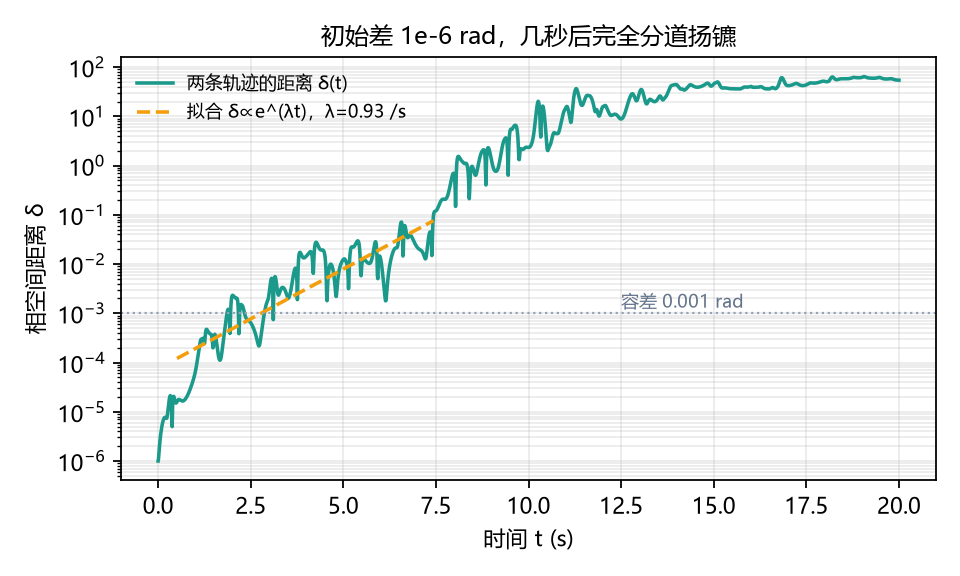
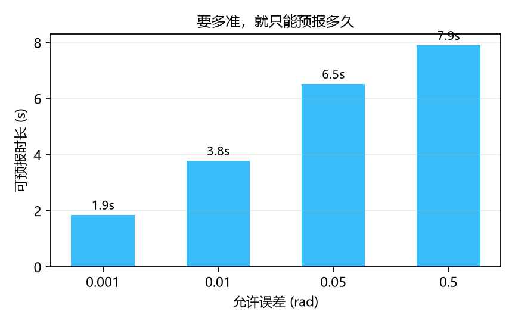
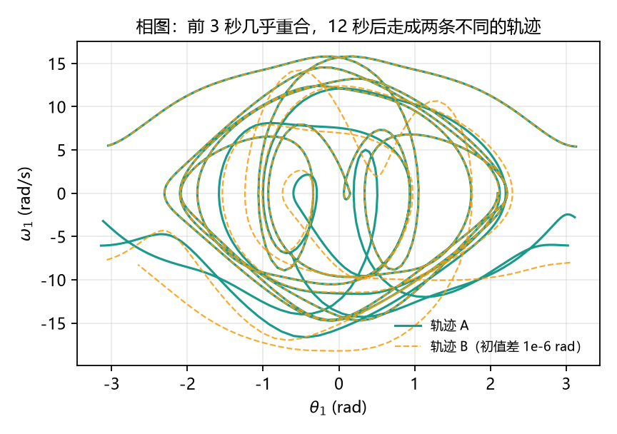

# 【做中学·探未来 | 科学探究】双摆为什么测不准：用一块单片机算出混沌的上限

> **一句话简介**：在行空板 K10 上同时积分两个双摆，初值只差 1e-6 rad，实时画出相图与分离曲线，拟合出李雅普诺夫指数 λ≈0.93/s，再据此算出"要想预报准 0.001 rad，只能预报 1.9 秒"。

---

## 一、一个能被"算出来"的问题

天气预报为什么只能报一周？三体问题为什么没有解析解？蝴蝶效应到底有多快？

它们指向同一件事：**混沌**——确定性系统对初值极端敏感。

双摆是最好的教具：两根杆、一个支点，方程完全确定，没有随机、没有摩擦。但只要初始角度差百万分之一弧度，两条轨迹几秒后就会彻底分开。

这个项目做的事很朴素：**把"几秒"量出来。**

## 二、原理

### 运动方程

双摆没有解析解，只能数值积分。状态是 $(θ_1, ω_1, θ_2, ω_2)$：

```
θ̈₁ = [−g(2m₁+m₂)sinθ₁ − m₂g·sin(θ₁−2θ₂) − 2sin(θ₁−θ₂)·m₂(ω₂²L₂+ω₁²L₁cos(θ₁−θ₂))]
      / [L₁(2m₁+m₂−m₂cos(2θ₁−2θ₂))]

θ̈₂ = [2sin(θ₁−θ₂)(ω₁²L₁(m₁+m₂) + g(m₁+m₂)cosθ₁ + ω₂²L₂m₂cos(θ₁−θ₂))]
      / [L₂(2m₁+m₂−m₂cos(2θ₁−2θ₂))]
```

### 李雅普诺夫指数

两条轨迹的距离按指数增长：

```
δ(t) ≈ δ₀ · e^(λt)
```

λ 就是李雅普诺夫指数。它给出可预报上限：

```
T_pred ≈ (1/λ) · ln(Δ/δ₀)
```

Δ 是容许误差。**λ 越大，能预报的时间越短。**

## 三、装置与做法

```
        行空板 K10
      ┌──────────────┐
      │ RK4 积分 ×2  │  两条初值只差 1e-6
      │ 相图 + λ 估计│
      │ CSV 记录     │
      └──────────────┘
        屏幕 / TF 卡
```

不需要任何传感器和外设——这是一个纯计算的实验台。K10 每 200 Hz 推进一步 RK4，屏幕上增量画相图，右侧实时显示 λ、δ 和时间。

| 按键 | 作用 |
|---|---|
| A | 重置（同一初值） |
| B | 切换初值差：1e-6 → 1e-3 → 1e-1 |

## 四、实验一：分离曲线

初值 θ₁=120°、θ₂=90°，两条轨迹只差 δ₀=1×10⁻⁶ rad。

| 量 | 结果 |
|---|---|
| 拟合区间 | 0.5 – 7.4 s |
| **λ** | **0.93 /s** |
| 7 秒后的距离 | ≈ 0.6（放大约 60 万倍） |



半对数坐标下是一条直线——指数增长的直接证据。

## 五、实验二：可预报时长

| 允许误差 (rad) | 可预报时长 (s) |
|---:|---:|
| 0.001 | 1.9 |
| 0.01 | 3.8 |
| 0.05 | 6.5 |
| 0.5 | 7.9 |



两个结论：

1. **精度提高 10 倍，预报只多 2.5 秒**——这是指数规律的直接后果（ln10/λ ≈ 2.5 s）；
2. 误差超过 0.5 rad 后不再增长，因为相空间有界，两条轨迹最终都跑遍整个吸引域。

## 六、实验三：相图



前 3 秒两条曲线几乎完全重合，画在一起看不出区别；12 秒后已经走成两条完全不同的路径。

**这就是"测不准"的几何图像**：不是量得不够准，是指数放大让任何有限精度都失效。

## 七、代码

K10 端 `main_chaos.cpp`（约 300 行，纯 Arduino C++）：

| 模块 | 做法 |
|---|---|
| 积分 | RK4，200 Hz |
| 显示 | 相图增量绘制，只画新线段，避免整屏重绘卡顿 |
| λ 估计 | 对 ln δ 做滑动最小二乘（40 点，每 50 ms 一个） |
| 记录 | CSV 写 TF 卡 |
| 交互 | A 重置，B 切换初值差 |

```cpp
/* 两条轨迹，初值只差 g_delta */
sA = {TH1_0, 0, TH2_0, 0};
sB = {TH1_0 + g_delta, 0, TH2_0, 0};
...
float sep = separation(sA, sB);     // 相空间距离
```

## 八、三课时怎么上

| 课时 | 内容 |
|---|---|
| 1 | 现象：两个几乎一样的摆，为什么几秒后完全不同？ |
| 2 | 测量：跑两组初值，导出 CSV，画半对数图，拟合 λ |
| 3 | 推论：由 λ 算可预报时长；聊三体、天气、台球 |

## 九、还能往哪走

- 改变初始能量，看 λ 怎么变（有序区 λ→0，混沌区 λ>0）
- 加一点阻尼，观察混沌是否消失
- 同一套代码做平面限制性三体问题

## 十、附件

- `main_chaos.cpp`：K10 端实时积分与相图
- `sim_chaos.py`：数值实验与出图
- `divergence.csv`、`predict_horizon.csv`：数据
- `metrics.json`：λ 与可预报时长汇总
- 三张图

本作品代码 MIT，文档 CC BY-NC-SA 4.0。转载请注明来自 DF 创客社区。

---

**标签**：创客活动 / 行空板K10 / DFRobot / Arduino / 做中学·科学探究实践

<sub>* 数据为仿真示例，用于演示流程；换成 K10 记录的 chaos_*.csv 后重跑脚本即可。</sub>
