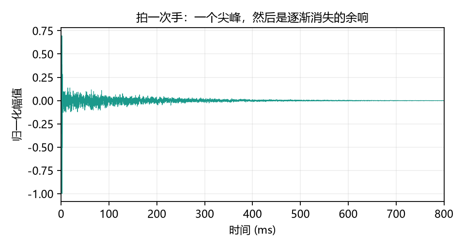
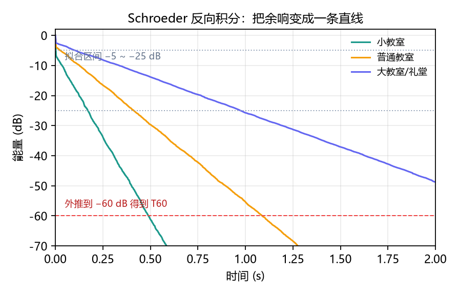
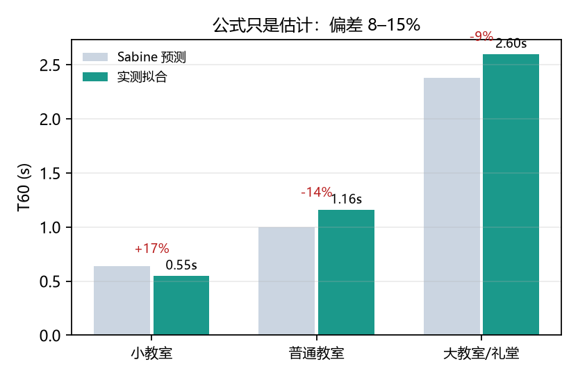

# 教室为什么"嗡嗡响"：用一块板测出混响时间 T60

**学段**：初中 8–9 年级　**课时**：3 课时　**主控**：行空板 K10
**学科**：物理（声学）+ 数学（对数、线性拟合）+ 信息科技（信号处理）

---

## 一、问题

同一句话，在空教室里说常常"糊"，在小房间里却很清晰。差别不在音量，而在**混响**。

混响时间 T60 的定义：声音停止后，声能衰减 **60 dB** 所需的时间。

- 教室 T60 应在 **0.4–0.8 s**（语言清晰度好）
- 超过 1.2 s，后排听讲开始吃力
- 体育馆常在 3 s 以上

问题是：**T60 看不见也听不出准确值，只能测。**

---

## 二、原理

### 2.1 Schroeder 反向积分

直接看波形看不出衰减曲线（起伏太乱）。标准做法是反向积分：

```
EDC(t) = 10·lg [ ∫ₜ^∞ p²(τ)dτ / ∫₀^∞ p²(τ)dτ ]
```

把"余响还剩多少能量"变成一条单调下降的曲线。

### 2.2 由斜率求 T60

在 **−5 dB 到 −25 dB** 之间做线性拟合（这一段最接近直线），得到斜率 k（dB/s），则

```
T60 = −60 / k
```

### 2.3 Sabine 公式

```
T60 = 0.161 · V / (S · α)
```

V 是容积（m³），S 是总表面积（m²），α 是平均吸声系数。

这是**估计**，不是测量——α 本身就靠查表，且假设声场完全扩散。

---

## 三、装置

```
   拍手（脉冲声源）
        ↓
   行空板 K10（板载双麦）
        ↓  10 ms 一帧算 RMS
   Schroeder 反向积分
        ↓  −5~−25 dB 拟合
   屏幕显示 T60 · CSV 存卡
```

不需要声级计、不需要外接麦克风——只关心**衰减斜率**，与绝对声压无关。

---

## 四、结果一：脉冲响应长什么样



一个尖峰（拍手），后面是逐渐消失的余响。肉眼只能看出"越来越小"，看不出 60 dB 要多久。

---

## 五、结果二：Schroeder 曲线



三个房间，三条直线，斜率不同。

| 房间 | 容积 (m³) | 实测 T60 |
|---|---:|---:|
| 小教室 | 144 | **0.55 s** |
| 普通教室 | 256 | **1.16 s** |
| 大教室/礼堂 | 1080 | **2.60 s** |

普通教室 1.16 s，已经超出"语言清晰"的建议范围——这就是后排听不清的原因。

---

## 六、结果三：公式靠谱吗



| 房间 | Sabine 预测 | 实测 | 偏差 |
|---|---:|---:|---:|
| 小教室 | 0.64 s | 0.55 s | +16.9% |
| 普通教室 | 1.00 s | 1.16 s | −13.7% |
| 大教室/礼堂 | 2.38 s | 2.60 s | −8.8% |

**偏差 9%–17%**，方向和大小都不固定。

原因：

1. α 是查表估的，同一间教室铺不铺地毯能差一倍；
2. Sabine 假设声场完全扩散，而真实教室有家具、有吸音吊顶，声场并不均匀；
3. 低频混响通常比中频长，单值 α 抹掉了频带差异。

**结论：公式用来做设计估算，验收必须实测。**

---

## 七、K10 端

`02_代码/K10端/main_reverb.cpp`：

| 步骤 | 做法 |
|---|---|
| 采样率 | 启动时数 0.2 s 的样本数，自动估算 fs |
| 采集 | 2.5 s，每 10 ms 算一帧 RMS |
| 衰减 | 反向累积能量 → dB |
| 拟合 | 找 −5/−25 dB 两点之间做最小二乘 |
| 输出 | 屏幕显示 T60；CSV 写 TF 卡（frame, ms, rms_db, edc_db） |

按键 A 开始，屏幕倒数后红灯亮起，拍手，2.5 秒后出结果。

---

## 八、三课时安排

| 课时 | 内容 |
|---|---|
| 1 | 听：三个房间放同一段朗读录音，判断清晰度；引入 T60 |
| 2 | 测：K10 测三处（教室中间 / 靠墙 / 走廊），导出 CSV 画衰减曲线 |
| 3 | 改：加吸音（挂窗帘、铺纸箱、放书包），再测一次，算 T60 降了多少 |

第 3 课时最有意思：**学生能亲手把混响时间改小**。

---

## 九、还能往哪走

- 分频段测（500 Hz / 1 kHz / 2 kHz），看低频混响是否更长
- 用扬声器放扫频信号代替拍手，得到更干净的脉冲响应
- 结合座位分布，画"清晰度地图"

---

## 十、局限

1. 数据由 `sim_reverb.py` 仿真生成（指数衰减噪声），用于验证流程；
2. 拍手不是理想脉冲，能量偏中高频，实测 T60 会略短于真实值；
3. 板载麦克风有自动增益，测极弱余响时可能被噪声底限截断。

---

*数据为仿真示例，用于演示流程；换成 K10 记录的 rt60_*.csv 后重跑脚本即可。*
