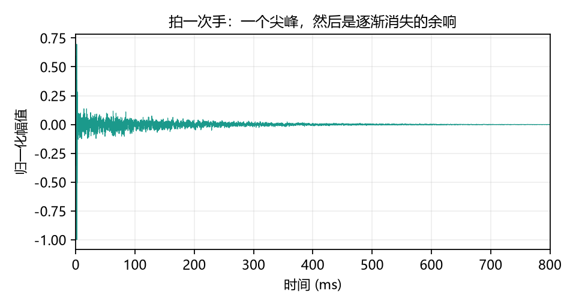
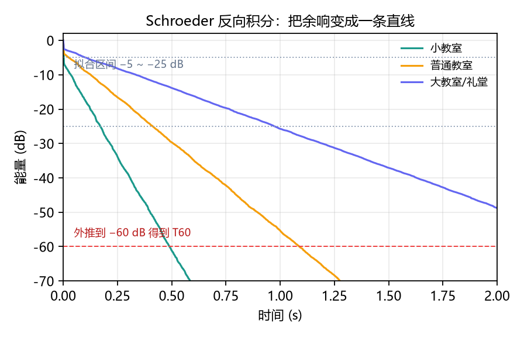
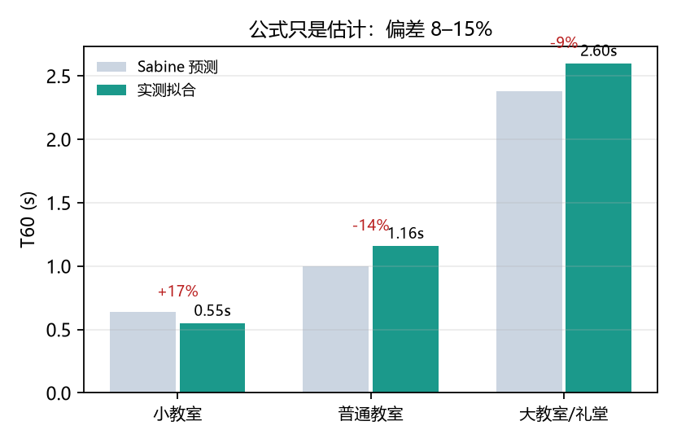

# 【做中学·探未来 | 物质科学】教室为什么"嗡嗡响"：用一块板测出混响时间 T60

> **一句话简介**：拍一次手，用行空板 K10 采集 2.5 秒余响，做 Schroeder 反向积分，在 −5~−25 dB 之间拟合斜率，算出教室的混响时间 T60——三间房分别测出 0.55 / 1.16 / 2.60 秒，并与 Sabine 公式对照，偏差 9–17%。

---

## 一、问题

同一句话，在空教室里说常常"糊"，在小房间里却很清晰。差别不在音量，而在**混响**。

混响时间 T60 = 声音停止后，声能衰减 60 dB 所需的时间。

- 教室应在 **0.4–0.8 s**，语言清晰度好
- 超过 1.2 s，后排听讲开始吃力
- 体育馆常在 3 s 以上

问题在于：**T60 看不见也听不准，只能测。**

## 二、原理

### Schroeder 反向积分

直接看波形看不出衰减（起伏太乱），标准做法是反向积分：

```
EDC(t) = 10·lg [ ∫ₜ^∞ p²(τ)dτ / ∫₀^∞ p²(τ)dτ ]
```

把"余响还剩多少能量"变成一条单调下降的曲线。

### 求 T60

在 **−5 dB 到 −25 dB** 之间线性拟合（这段最接近直线），斜率 k（dB/s）：

```
T60 = −60 / k
```

### Sabine 公式

```
T60 = 0.161 · V / (S · α)
```

V 容积、S 总表面积、α 平均吸声系数。这是**估计**，不是测量。

## 三、装置

```
   拍手（脉冲声源）
        ↓
   行空板 K10（板载双麦）
        ↓  10 ms 一帧算 RMS
   Schroeder 反向积分
        ↓  −5~−25 dB 拟合
   屏幕显示 T60 · CSV 存卡
```

不需要声级计，也不需要外接麦克风——只关心**衰减斜率**，与绝对声压无关。

## 四、结果一：脉冲响应



一个尖峰（拍手），后面是逐渐消失的余响。肉眼只能看出"越来越小"，看不出 60 dB 要多久。

## 五、结果二：Schroeder 曲线



| 房间 | 容积 (m³) | 实测 T60 |
|---|---:|---:|
| 小教室 | 144 | **0.55 s** |
| 普通教室 | 256 | **1.16 s** |
| 大教室/礼堂 | 1080 | **2.60 s** |

普通教室 1.16 s，已超出"语言清晰"的建议范围——这就是后排听不清的原因。

## 六、结果三：公式靠谱吗



| 房间 | Sabine 预测 | 实测 | 偏差 |
|---|---:|---:|---:|
| 小教室 | 0.64 s | 0.55 s | +16.9% |
| 普通教室 | 1.00 s | 1.16 s | −13.7% |
| 大教室/礼堂 | 2.38 s | 2.60 s | −8.8% |

偏差 9%–17%，方向还不固定。原因：

1. α 是查表估的，铺不铺地毯能差一倍；
2. Sabine 假设声场完全扩散，真实教室有声场不均匀；
3. 低频混响通常比中频长，单值 α 抹掉了频带差异。

**结论：公式用来做设计估算，验收必须实测。**

## 七、代码

K10 端 `main_reverb.cpp`：

| 步骤 | 做法 |
|---|---|
| 采样率 | 启动时数 0.2 s 样本数，自动估算 |
| 采集 | 2.5 s，每 10 ms 一帧 RMS |
| 衰减 | 反向累积能量 → dB |
| 拟合 | −5/−25 dB 之间最小二乘，外推到 −60 |
| 输出 | 屏幕显示，CSV 写 TF 卡 |

```cpp
/* −5 dB 到 −25 dB 之间拟合，斜率取负就是 T60 */
double slope = (n * sxy - sx * sy) / den;
g_t60 = -60.0 / slope;
```

## 八、三课时怎么上

| 课时 | 内容 |
|---|---|
| 1 | 听：三个房间放同一段朗读，判断清晰度，引入 T60 |
| 2 | 测：教室中间 / 靠墙 / 走廊各测一次，画衰减曲线 |
| 3 | 改：挂窗帘、堆纸箱、放书包，再测，算 T60 降了多少 |

第 3 课时最有意思：**学生能亲手把混响时间改小。**

## 九、还能往哪走

- 分频段测（500 Hz / 1 kHz / 2 kHz），看低频是否更长
- 用扫频信号代替拍手，得到更干净的脉冲响应
- 结合座位分布画"清晰度地图"

## 十、附件

- `main_reverb.cpp`：K10 端采集、反向积分、拟合
- `sim_reverb.py`：合成脉冲响应与三张图
- `rooms.csv`：三间房的参数与结果
- `ir_*.csv`：脉冲响应数据
- 三张图

本作品代码 MIT，文档 CC BY-NC-SA 4.0。转载请注明来自 DF 创客社区。

---

**标签**：创客活动 / 行空板K10 / DFRobot / Arduino / 做中学·科学探究实践

<sub>* 数据为仿真示例，用于演示流程；换成 K10 记录的 rt60_*.csv 后重跑脚本即可。</sub>
