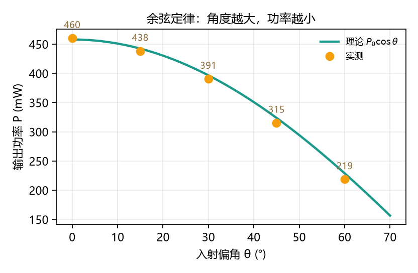
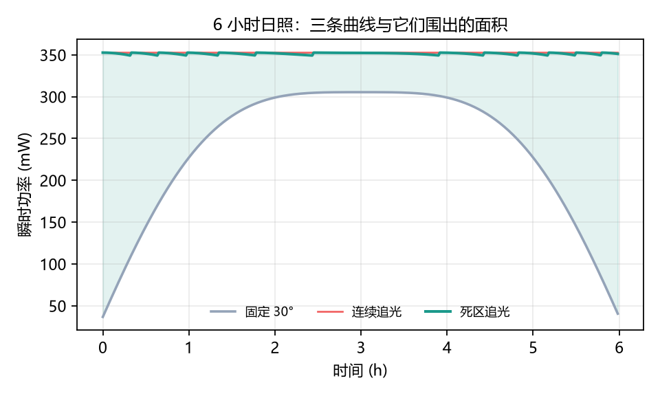
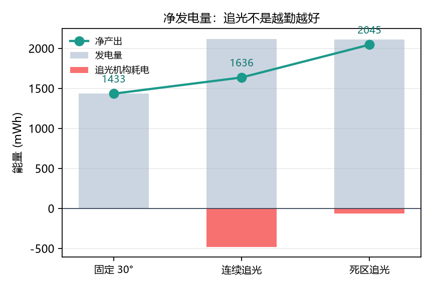
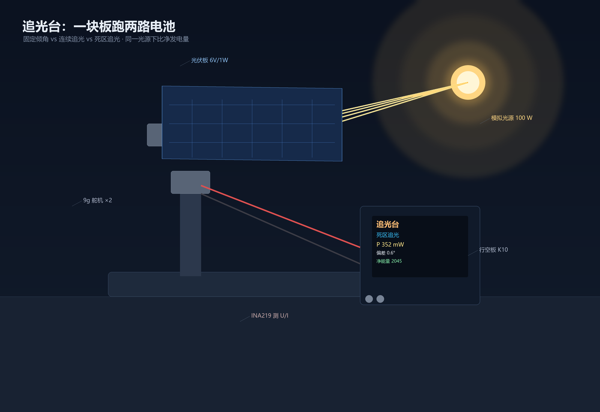

# 追光台：一块板跑两路电池，究竟能多收多少电？

**赛道**：五【新兴产业】　**学段**：初中 8–9 年级　**课时**：3 课时
**主控**：行空板 K10（DFR0992-EN）
**外设**：二哈识图 2（视觉)、9g 舵机 ×2、INA219 功率计、6V/1W 光伏板

> ⚠️ 数据说明：本文件中的实验数据为**仿真示例**（`../02_代码/分析端/sim_solar.py` 生成），
> 用于验证“采集—分析—成图—成文”的完整流程。换成 K10 记录的 `solar_*.csv` 后重跑，
> 全部数字与图会自动更新。

---

## 一、问题从哪来

学生在物理课学过「太阳高度角」，在数学课学过「余弦」，但很少有人把两者接起来算一笔账：

> **如果我的太阳能板一直正对太阳，一天到底能多发多少电？值不值得为它装一套舵机？**

市面上的追光作品大多停在「四个光敏电阻比大小 → 转过去 → 灯亮了」，有两个常见缺陷：

1. **不算功耗**：舵机与传感器本身要吃电，转得越勤，吃掉的越多；
2. **缺少定量对比**：只演示「追上了」，没回答「多收了几度电」。

本项目把这两件事都算清楚：**用同一块板、同一个光源、同一段日照，比较三种策略的净发电量**。

---

## 二、三个策略

| 组别 | 做法 | 特点 |
|---|---|---|
| **A 固定** | 板面固定 30° 倾角、朝正南 | 对照组，零功耗 |
| **B 连续追光** | 每 200 ms 用视觉误差修正一次 | 始终正对，但舵机与视觉常开 |
| **C 死区追光** | 偏差 > 8° 才动，动完休眠 | 少动、少耗电 |

死区（deadband）是控制工程里的常规手段：**允许一点误差，换取执行机构少动作**。
把它用在追光上，就是本项目要验证的核心假设。

---

## 三、装置与原理

```
        台灯（模拟太阳）
             ↘
          光伏板 ── 舵机云台（水平/俯仰）
             │
          INA219（测 U、I）
             │
        行空板 K10 ── 屏幕 / TF 卡
             ↑
      二哈识图 2（找光斑质心）
```

两块原理：

**1. 余弦定律**

板面法线与光线的夹角为 θ 时，

```
P(θ) = P₀ · cos θ
```

θ = 0 时功率最大，θ = 60° 时只剩一半。

**2. 净能量**

```
E_net = ∫ P(t) dt − E_cost
```

`E_cost` 是追光机构自身的耗电。**只比 `E_gen` 不比 `E_cost`，结论会反过来。**

---

## 四、实测（仿真示例）结果

### 4.1 余弦定律验证

| θ | cos θ | U (V) | I (mA) | P 实测 (mW) | P 理论 (mW) | 相对误差 |
|---:|---:|---:|---:|---:|---:|---:|
| 0° | 1.000 | 5.41 | 85.1 | 460.3 | 458.0 | +0.5% |
| 15° | 0.966 | 5.31 | 82.5 | 438.3 | 442.4 | −0.9% |
| 30° | 0.866 | 5.18 | 75.5 | 390.7 | 396.6 | −1.5% |
| 45° | 0.707 | 5.08 | 62.1 | 315.3 | 323.9 | −2.6% |
| 60° | 0.500 | 4.94 | 44.3 | 218.8 | 229.0 | −4.4% |

平均绝对误差 **2.0%**，最大 **4.4%**（出现在 60°，表面反射加剧）。
结论：**在 0–60° 范围内，余弦定律成立，可以作为后续模型的基础。**



### 4.2 三策略的净发电量

6 小时日照（高度角 12° → 60° → 12°，方位角 ±45°）：

| 组别 | 发电量 E_gen | 追光耗电 E_cost | 净产出 E_net | 相对 A |
|---|---:|---:|---:|---:|
| A 固定 30° | 1433 mWh | 0 | 1433 mWh | — |
| B 连续追光 | 2116 mWh | 480 mWh | **1636 mWh** | **+14.1%** |
| C 死区追光 | 2109 mWh | 64 mWh | **2045 mWh** | **+42.7%** |





**这是本项目最想让学生看到的一行：**

> B 组发电量最高（2116），净产出却只有 1636；
> C 组少发了 7 mWh，却因为只动了 12 次，净产出多了 409 mWh。

**追光的收益不在“转得快”，而在“少转”。**

---

## 五、装置示意



> 图为**示意图**（按实际接线绘制），非实拍。

---

## 六、代码

`../02_代码/K10端/main_solar.cpp`（约 400 行）：

| 模块 | 做法 |
|---|---|
| 视觉 | 读二哈识图 2 的 I2C 结果寄存器，取光斑质心，归一化到 −1..1 |
| 控制 | 增量式 PID + 死区判断，输出限幅 ±6°/周期 |
| 舵机 | LEDC 直接出 50 Hz PWM（0.5–2.5 ms），不依赖额外库 |
| 计量 | INA219 读总线电压与电流，P = U·I |
| 记录 | 每周期一行 CSV 写 TF 卡：`t_ms,err_deg,angle_deg,volt,curr_ma,p_mw,moved` |
| 交互 | A 键切策略，B 键归零；屏幕显示策略/功率/偏差/净能量 |

`../02_代码/分析端/sim_solar.py`：生成示例数据与三张图。

---

## 七、三课时怎么上

| 课时 | 内容 |
|---|---|
| 1 | 余弦定律：用手电筒和光伏板测 5 个角度，验证 P = P₀cosθ |
| 2 | 搭追光台：装舵机、接 INA219、烧固件，跑通三种策略 |
| 3 | 算账：导出 CSV，算 E_net，画柱状图，讨论“为什么 C 比 B 好” |

---

## 八、还能往哪走

- 加云层遮挡实验：突然挡光，看三种策略的恢复时间
- 换成真实太阳：一天 8 小时，看死区阈值取 5°/8°/12° 的差别
- 加第二块板做“双轴 vs 单轴”对比

---

## 九、已知局限

1. 数据为仿真示例，真实效率受温升、云层、风速影响，数值会偏；
2. 舵机耗电按“每次动作 320 mW × 1 分钟”估算，实测应改用 INA219 串在舵机供电上；
3. 二哈识图 2 的 I2C 寄存器地址以实测为准，代码里给了常量，改一处即可。
