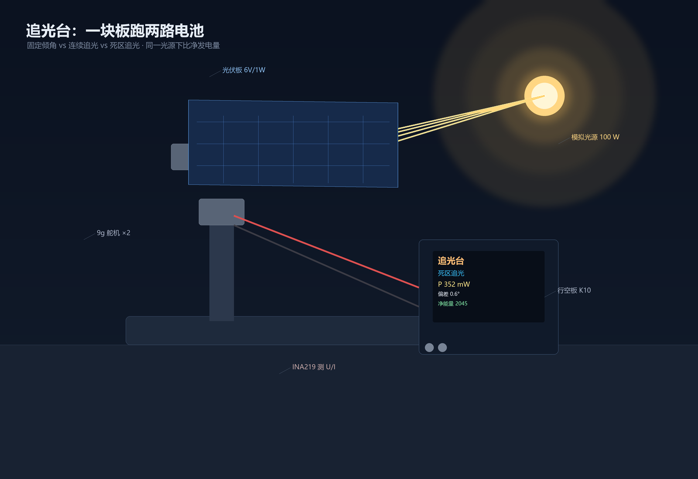
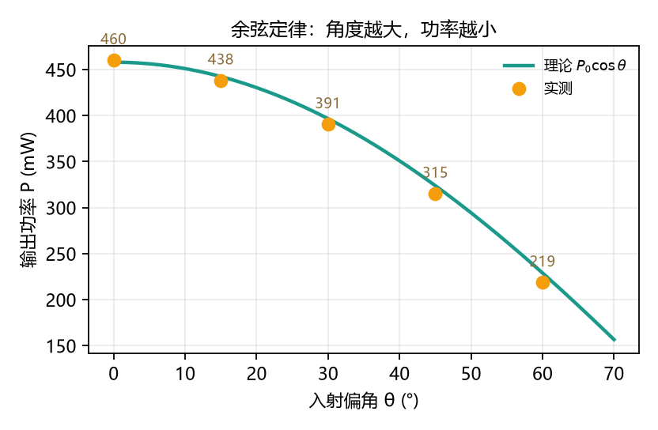
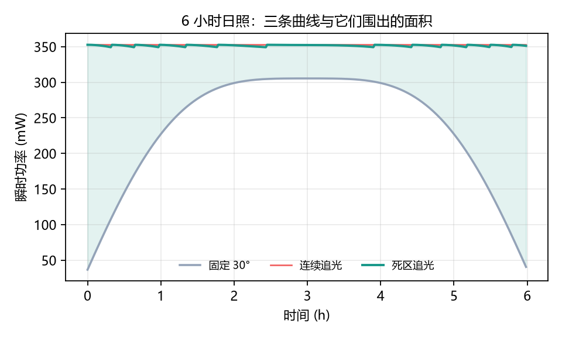
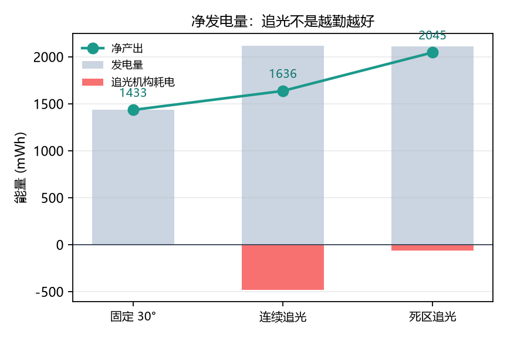

# 【做中学·探未来 | 新兴产业】追光台：一块板跑两路电池 —— 追光到底能多收多少电？

> **一句话简介**：用行空板 K10 + 二哈识图 2 + 两个 9g 舵机 + 一块 6V 光伏板，把"追光"这件事算成一本账：同样的日照下，固定、连续追光、死区追光三种策略，扣掉舵机自己吃的电，各自净赚多少毫瓦时。

---

## 一、为什么做这个

物理课讲太阳高度角，数学课讲余弦，但很少有学生把两者接起来算一笔账：

> 太阳能板一直正对太阳，一天到底能多发多少电？值不值得为它装舵机？

市面上的追光作品大多停在"四个光敏电阻比大小 → 转过去 → 灯亮了"，有两个问题：

1. **不算功耗**——舵机和传感器自己也要吃电，转得越勤吃掉的越多；
2. **没有定量对比**——只演示"追上了"，不回答"多收了多少"。

所以这个项目只做一件事：**同一个光源、同一段日照，比三种策略的净发电量。**

## 二、三个策略

| 组别 | 做法 | 特点 |
|---|---|---|
| A 固定 | 板面固定 30°、朝正南 | 对照组，零功耗 |
| B 连续追光 | 每 200 ms 修正一次 | 始终正对，但舵机与视觉常开 |
| C 死区追光 | 偏差 > 8° 才动，动完休眠 | 少动、少耗电 |

"死区（deadband）"是控制工程里的常规手段：允许一点误差，换执行机构少动作。把它用在追光上，就是本项目要验证的假设。

## 三、装置



```
        台灯（模拟太阳）
             ↘
          光伏板 ── 舵机云台（水平/俯仰）
             │
          INA219（测 U、I）
             │
        行空板 K10 ── 屏幕 / TF 卡
             ↑
      二哈识图 2（找光斑质心）
```

## 四、原理

**余弦定律**：板面法线与光线夹角为 θ 时

```
P(θ) = P₀ · cos θ
```

**净能量**：

```
E_net = ∫P(t)dt − E_cost
```

只比发电量不比耗电，结论会反过来。

## 五、实验一：余弦定律成立吗

| θ | cos θ | U (V) | I (mA) | P 实测 (mW) | P 理论 (mW) | 相对误差 |
|---:|---:|---:|---:|---:|---:|---:|
| 0° | 1.000 | 5.41 | 85.1 | 460.3 | 458.0 | +0.5% |
| 15° | 0.966 | 5.31 | 82.5 | 438.3 | 442.4 | −0.9% |
| 30° | 0.866 | 5.18 | 75.5 | 390.7 | 396.6 | −1.5% |
| 45° | 0.707 | 5.08 | 62.1 | 315.3 | 323.9 | −2.6% |
| 60° | 0.500 | 4.94 | 44.3 | 218.8 | 229.0 | −4.4% |

平均绝对误差 **2.0%**，最大 **4.4%**（60° 时表面反射加剧）。



## 六、实验二：三种策略，净赚多少

6 小时日照（高度角 12°→60°→12°，方位角 ±45°）：

| 组别 | 发电量 | 追光耗电 | 净产出 | 相对 A |
|---|---:|---:|---:|---:|
| A 固定 30° | 1433 mWh | 0 | 1433 mWh | — |
| B 连续追光 | 2116 mWh | 480 mWh | 1636 mWh | +14.1% |
| C 死区追光 | 2109 mWh | 64 mWh | **2045 mWh** | **+42.7%** |





**最想让学生看到的一行**：

> B 组发电最多（2116），净产出却只有 1636；
> C 组少发 7 mWh，因为只动了 12 次，净产出多了 409 mWh。

**追光的收益不在"转得快"，在"少转"。**

## 七、代码

K10 端 `main_solar.cpp`（约 400 行，纯 Arduino C++）：

| 模块 | 做法 |
|---|---|
| 视觉 | 读二哈识图 2 的 I2C 结果寄存器，取光斑质心，归一化到 −1..1 |
| 控制 | 增量式 PID + 死区判断，输出限幅 ±6°/周期 |
| 舵机 | LEDC 直接出 50 Hz PWM，不依赖额外库 |
| 计量 | INA219 读总线电压与电流，P = U·I |
| 记录 | 每周期一行 CSV 写 TF 卡 |
| 交互 | A 键切策略，B 键归零 |

```cpp
/* 死区：偏差小于 8° 就不动，这是省电的关键 */
if (g_strategy == STRATEGY_DEADBAND && errMag < DEADBAND_DEG) {
  return;
}
```

## 八、三课时怎么上

| 课时 | 内容 |
|---|---|
| 1 | 余弦定律：手电筒 + 光伏板测 5 个角度 |
| 2 | 搭追光台：装舵机、接 INA219、烧固件，跑通三种策略 |
| 3 | 算账：导出 CSV，算 E_net，画柱状图，讨论"为什么 C 比 B 好" |

## 九、附件

- `main_solar.cpp`：K10 端完整程序
- `sim_solar.py`：数据处理与出图脚本
- `exp1_cos.csv` / `exp2_track.csv`：原始数据
- `metrics.json`：拟合与能量汇总

本作品代码 MIT，文档 CC BY-NC-SA 4.0。转载请注明来自 DF 创客社区。

---

**标签**：创客活动 / 行空板K10 / DFRobot / Arduino / 做中学·科学探究实践

<sub>* 表内数据为仿真示例，用于演示流程；实测请用 K10 记录的 CSV 替换后重跑脚本。</sub>
