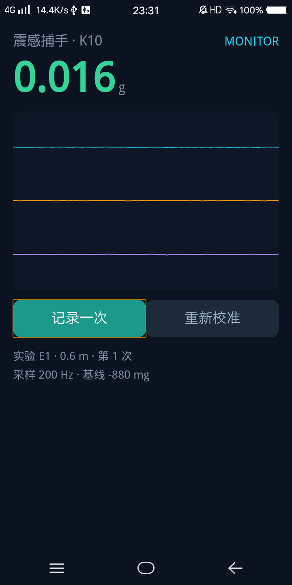
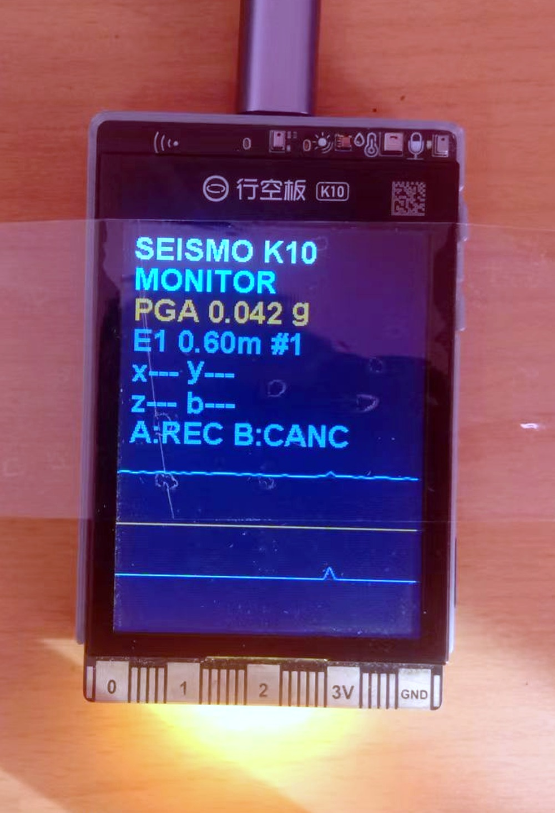

# 【功能拓展】震感捕手 v1.1：给 K10 加一个 Web 遥测端

> 已发布：https://mc.dfrobot.com.cn/article-387228.html
>
> 主帖：[震感捕手：用行空板 K10 给校园做一次“地震体检”](https://mc.dfrobot.com.cn/article-387097.html)
>
> v1.0 解决“能不能在教室里做一次可重复的地震”，v1.1 解决“做实验时人得蹲在板子前面看屏幕”。

## 一、为什么要加这个

主帖那个版本，记录完得低头看 K10 的 2.8 寸屏，峰值、主频、时长一行行读。
学生分组实验时，四个人围着巴掌大一块板子，后面两个根本看不见。

于是想：**把屏幕搬到手机上。**

K10 自带 WiFi，那就让它当一个小服务器，手机连上同一个网络，浏览器直接开。

## 二、做成了什么样

手机端：



- 顶部实时峰值（0.016 g 是静置噪声）
- 中间三条波形（X 青 / Y 橙 / Z 紫）
- 下面「记录一次」「重新校准」两个按钮
- 底部显示当前实验编号、距离、第几次、采样率、基线

K10 端：



屏幕只留最必要的：状态、峰值、IP。

## 三、架构

```
        ┌──────────────┐    WiFi     ┌──────────────┐
        │  K10 (ESP32) │◄───────────►│  手机 / 电脑  │
        │  WebServer   │  HTTP/JSON  │  浏览器 / APK │
        └──────────────┘             └──────────────┘
              │
         200 Hz 采样、写 TF 卡
```

四个接口：

| 路径 | 作用 |
|---|---|
| `/api/now` | 状态、峰值、基线 |
| `/api/wave` | 最近 120 点三轴波形（g，已去基线） |
| `/api/record` | 远程触发一次记录 |
| `/api/last` | 最近一次结果（峰值/主频/时长/轴向/文件） |

## 四、关键取舍

**1. HTTP 不能抢采样**
主循环 200 Hz，每 20 ms 服务一次 HTTP。采样用绝对时间戳推进，HTTP 花掉的 1–2 ms 不会累积成漂移。

**2. 记录时也不停服务**
记录那 4 秒里每 50 ms 服务一次，`/api/now` 返回 `RECORDING`，手机端就知道要等。

**五、怎么复刻**

1. 烧固件：Mind+ 代码模式，粘贴 `web/02_代码/v0/main_web.cpp`，板型行空板 K10
2. 配网：首启开热点 `K10-Seismo-Setup`，手机连上，浏览器进 `192.168.4.1` 填 WiFi
3. 装 App：`web/02_代码/震感捕手_遥测版.apk`
4. 连：看 K10 屏幕第 5 行的 IP，App 里填进去

## 六、踩过的坑

**配网后 App 灰屏**
K10 从热点模式切到路由器模式，IP 从 `192.168.4.1` 变成路由器分配的地址，App 还记着旧地址。
解决：加 mDNS（`seismo.local`）+ 自动回退 + 失败提示页。

**中文路径编译不了 APK**
AGP 报 `non-ASCII characters`。解决：同步到 `C:\tools\seismo_android` 再编译。

## 七、下一步

- WebSocket 替代轮询，延迟 200 ms → 20 ms
- `/api/export` 直接下 CSV
- 多台 K10 组网做“校园震感地图”

---

完整源码与 APK：[遥测版_源码与APK.zip](../02_代码/遥测版_源码与APK.zip)
