# 【做中学·探未来｜地球奥秘】震感捕手：用行空板 K10 给校园做一次“地震体检”

> **一句话简介**：一根纸筒、一颗钢球、一块行空板 K10，加上两张拼起来的课桌，就能在教室里做一次“可重复的地震”——记录波形、拟合衰减、盲测震源距离、比较三种建筑的抗震表现。

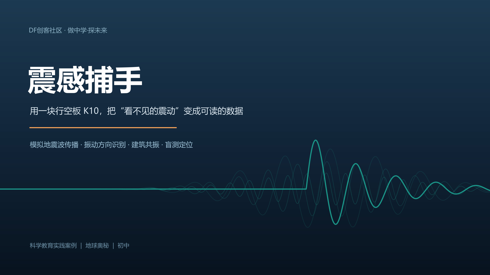

| 项目 | 内容 |
| --- | --- |
| 作品方向 | 地球奥秘（模拟地震波探测） |
| 适用学段 | 初中 7–9 年级 |
| 主控硬件 | 行空板 K10（DFR0992-EN，板载 SC7A20H 三轴加速度计） |
| 编程环境 | Arduino C++（Arduino IDE / PlatformIO）+ 电脑端 Python 3 |
| 建议课时 | 3 课时 |
| 材料成本 | 约 380 元/套（含 K10 与 TF 卡） |
| 开源许可 | MIT |

---

## 一、为什么做这个：疏散演练后的三个问题

学校组织地震疏散演练，演练结束后学生在楼道里吵成一片：

- 为什么二楼教室的吊灯晃得比一楼厉害？
- 如果地震真的来了，我们在三楼还有多少时间？
- 电视里的地震台，是怎么知道震中在哪里的？

这三个问题都指向地震波。但真实地震不可预测、不可重复、更不可控，课堂上不可能“做”一次地震。

于是我们把问题缩小成一个**能在教室里回答**的形式：

> **能不能用一块行空板 K10，在两张课桌拼成的台面上，做出一次可重复、可测量、可比较的“模拟地震”？**

行空板 K10 刚好把需要的东西都集成在一块 51.6 × 83 mm 的板子上：三轴加速度计、2.8 寸彩屏、A/B 按键、RGB 灯、TF 卡槽、锂电池接口。不用面包板、不用杜邦线，学生可以把注意力放在“怎么问一个能被数据回答的问题”上。

---

## 二、成品演示

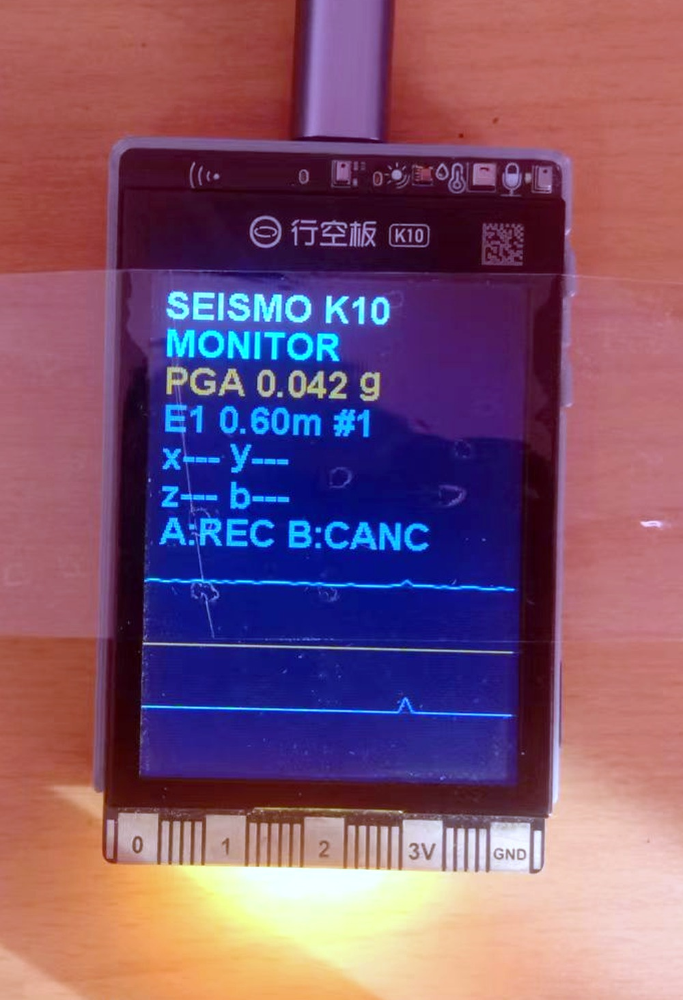

*成品实拍：K10 平放在桌面上电运行，屏幕显示监测页与实时峰值（调试阶段为英文界面，正式版已支持中文）*

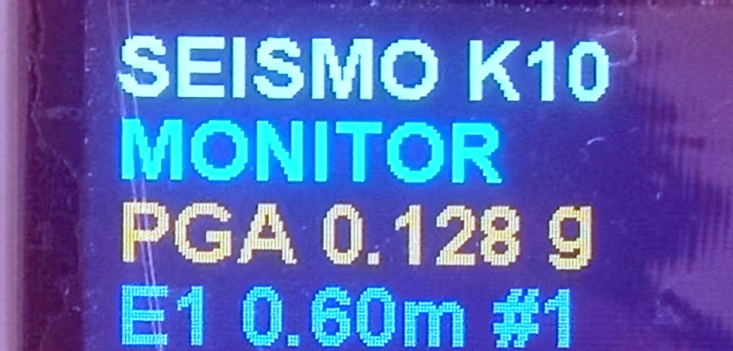

*屏幕特写：状态、峰值 0.128 g 与实验编号*

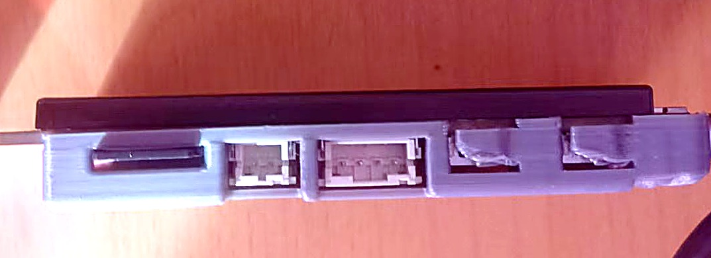

*侧面接口：TF 卡槽、两组 3Pin、Type-C，全部板载*

### 视频演示

**视频演示（1 分 57 秒）：** https://www.bilibili.com/video/BV1zEWt6TEV2/

*1 分 57 秒，完整演示：上电 → 等待触发 → 落球 → 波形跳动 → 记录完成*

**三步操作：**

1. **上电**：插电池或 USB-C，按 RST，屏幕出现启动画面，RGB 绿灯呼吸。
2. **待机**：K10 平放在测点，屏幕朝向自己，静置 10 s，读数应小于 0.005 g。
3. **记录**：按 A 键 → 落球 → 屏幕先显示 `等待触发`，触发后 RGB 转红、数据开始记录，约 4 s 后显示 `记录完成`。

记录完成后屏幕直接给出这次的**峰值加速度、主振方向、主频估计、持续时长**。数据优先写 TF 卡（`S:/E1_d060_t1.csv`）；没插卡或写卡失败时，同一段 CSV 会从 USB 串口整块输出，电脑端用 `serial_capture.py` 接住。

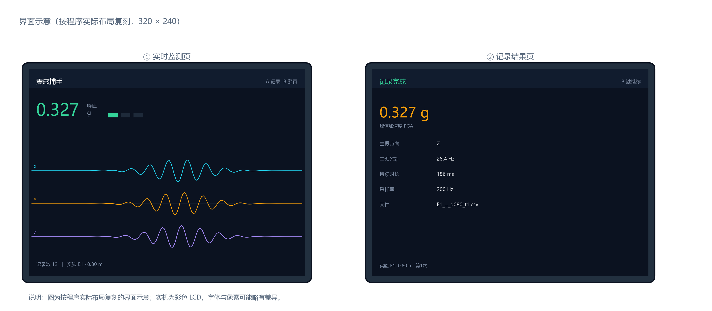


---

## 三、它是怎么“看见”震动的

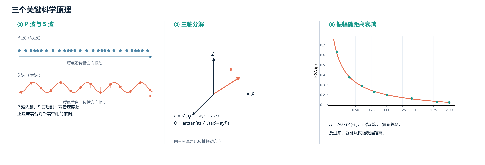

### 1. P 波与 S 波

地震时震源同时发出两种体波：**P 波是纵波**，质点沿传播方向振动，速度约 6 km/s；**S 波是横波**，质点垂直于传播方向振动，速度约 3.5 km/s。P 波先到、S 波后到，到时差随震中距增大——地震台就是靠这个“算”出震中距的。

### 2. 一个必须说明的取舍：为什么测“振幅”而不是“走时”

真实地震的震中距几十到几百公里，P/S 到时差有几秒到几十秒，很容易测。但在我们的桌面上，距离只有 2 m、波速以千米每秒计，走时只有零点几毫秒，而 K10 的采样间隔是 5 ms——**根本测不准走时差**。

所以本项目换了一个“可测的替代量”：**振幅随距离的衰减**。它同样携带距离信息，对采样率的要求低得多。这不是偷懒，而是科学探究里常见的做法：当直接观测量超出仪器能力时，选一个与目标量单调相关、能可靠测量的替代量，并老老实实说明它的适用条件。

### 3. 三轴分解

合加速度 `a = √(ax² + ay² + az²)`；去掉重力后，方向角 `θ = arctan(az / √(ax²+ay²))`。θ 接近 90° 说明以垂直振动为主，接近 0° 说明以水平振动为主——这正好对应 P 波与 S 波的偏振差异。

### 4. 衰减与共振

- **衰减**：二维面波近似 `A ∝ r^(-0.5)`，三维体波近似 `A ∝ r^(-1)`；叠加材料内摩擦后，指数介于两者之间。本项目用 `A = A0 · r^(-n)` 拟合。
- **共振**：把建筑模型看成单自由度振子，`f0 = (1/2π)·√(k/m)`。外界频率接近 f0 时顶部振幅被放大。

---

## 四、探究过程与结果

> **数据说明**：下面是**物理模型仿真的示例数据**，用来跑通“采集—分析—成图—成文”的完整流程。实测数据替换后，运行 `analyze.py` 与 `build_doc.py`，全文数字与图表会自动更新。

### 实验设计

| 实验 | 自变量 | 因变量 | 控制变量 | 重复 |
| --- | --- | --- | --- | --- |
| 一、距离衰减 | 测点距离 0.2–2.0 m（10 档） | 峰值加速度 PGA | 落球高度、钢球、桌面、测点朝向 | 每档 5 次 |
| 二、振动方向 | 垂直 / 水平 / 45° | 三轴 PGA、方向角 θ | 距离 0.60 m、落球高度 | 每种 5 次 |
| 三、建筑结构 | A 无斜撑 / B X 形斜撑 / C 斜撑+配重 | f0、阻尼比 ζ、顶部 PGA | 模型尺寸、敲击点、力度 | 每种 5 次 |
| 四、盲测 | 3 个未知位置 | 预测距离与误差 | 同实验一 | 每处 3 次 |

### 实验一：振幅怎样随距离衰减

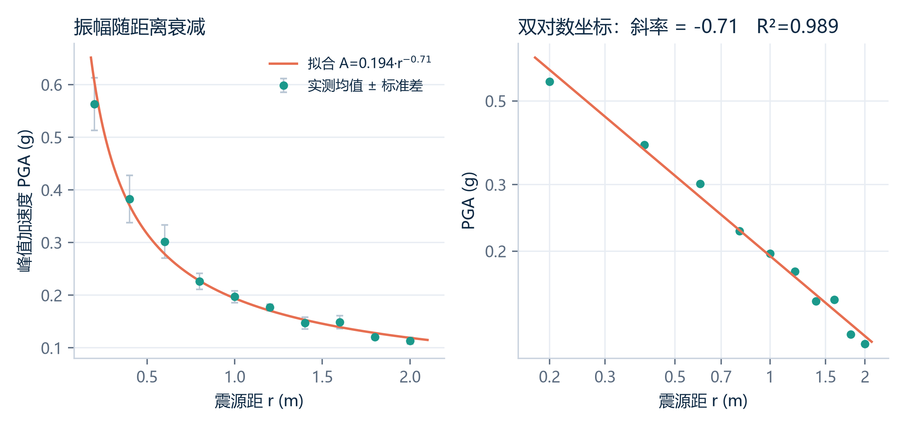

拟合结果：**A = 0.194 · r^(−0.706)，R² = 0.989**。从 0.20 m 到 2.00 m，PGA 从 0.563 g 降到 0.113 g，衰减为原来的 1/5。留一交叉验证的平均绝对误差 6.4%。

**怎么解释 n ≈ 0.71？** 纯二维面波是 0.5，纯三维体波是 1；实测介于两者之间，说明桌面上同时存在沿表面的波和穿过板厚的波，再加木材内摩擦把高频消耗掉，最终表现为“混合”的衰减指数。

### 实验二：三轴能不能分辨方向

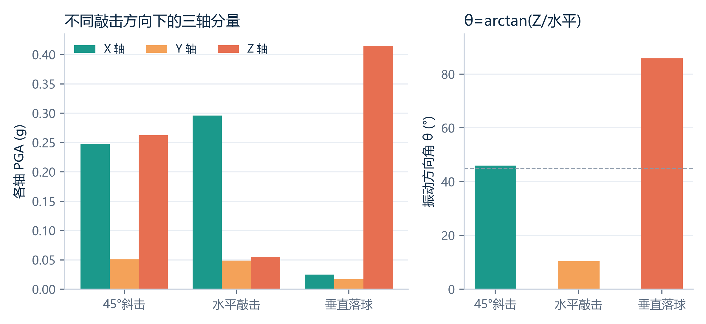

垂直、水平、45° 三种激励的方向角分别约为 **86°、10°、46°**，Z/水平 的比值分别是 13.9、0.18、1.04，相差两个数量级。三轴传感器不仅能“感到震”，还能判断“往哪个方向震”。

### 实验三：三种建筑模型

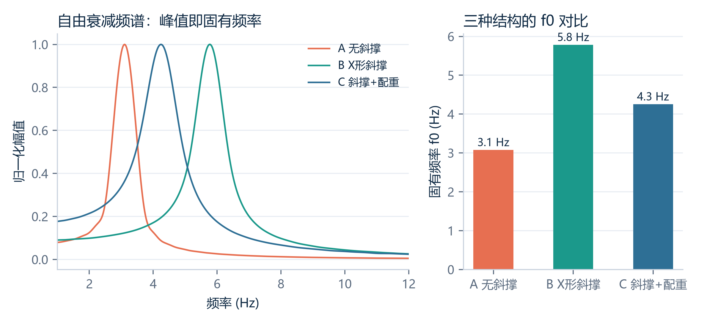

| 模型 | f0 (Hz) | 阻尼比 ζ | 顶部 PGA (g) | 相对 A 变化 |
| --- | --- | --- | --- | --- |
| A 无斜撑 | 3.07 | 0.038 | 0.335 | — |
| B X 形斜撑 | 5.78 | 0.063 | 0.134 | −60% |
| C 斜撑 + 配重 | 4.25 | 0.132 | 0.174 | −48% |

**斜撑**让结构更刚，f0 上移，顶部 PGA 下降 60%；**配重**让 f0 下降，但阻尼比提高一倍，PGA 反而比 B 高 30%——**抗震不是越硬越好，而是刚度、质量、阻尼的权衡**。

### 盲测：模型到底能不能用

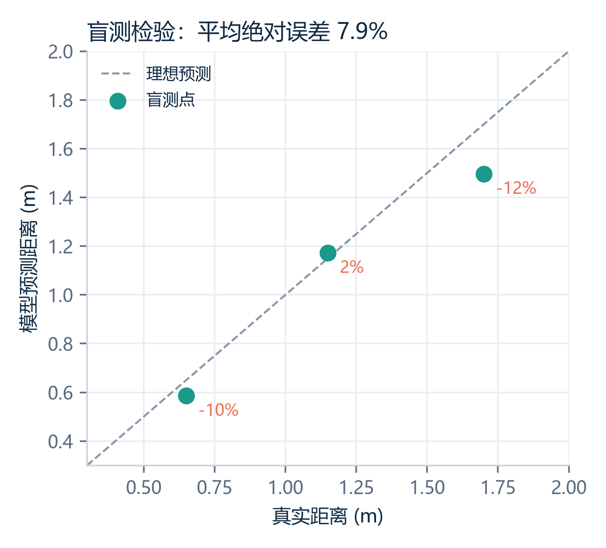

请另一组同学把落球装置移到三个未知位置，操作者不看卷尺，只用 PGA 反推距离，最后量真值。**三次平均绝对误差 7.9%**，最远的一次（1.70 m）被低估 12%——远处信号小、噪声占比大。改进办法不是“调参把误差压小”，而是增加重复次数、如实写清不确定度。

---

## 五、硬件清单

| 序号 | 名称 | 型号 / 规格 | 数量 | 参考价 |
| --- | --- | --- | --- | --- |
| 1 | 行空板 K10 | DFR0992-EN | 1 | 约 ¥299 |
| 2 | 钢球 | 直径 20 mm | 1 | ¥3 |
| 3 | 纸筒 / PVC 管 | 内径 25 mm，长 500 mm | 1 | ¥5 |
| 4 | 钢片 | 100 × 60 × 2 mm | 1 | ¥5 |
| 5 | 卷尺 | 3 m | 1 | ¥8 |
| 6 | 雪糕棒 | 114 × 10 × 2 mm | 约 120 根 | ¥10 |
| 7 | 热熔胶枪 + 胶棒 | 7 mm | 1 套 | ¥15 |
| 8 | 泡沫垫 | 10 mm 厚 | 4 片 | ¥10 |
| 9 | TF 卡 | 16 GB，FAT32 | 1 | ¥25 |
| 10 | 锂电池 | 3.7 V，PH2.0，≥1000 mAh | 1 | 选配 |

**连线？不需要。** 加速度计、屏幕、按键、RGB、TF 卡槽、电池接口全部板载。

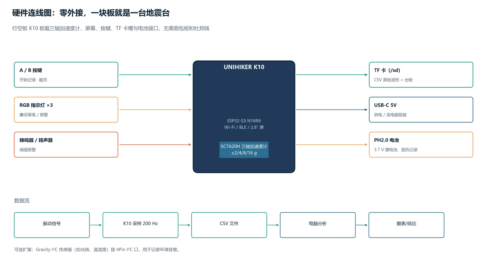

---

## 六、制作步骤

1. **搭实验台**（10 min）：两张课桌拼成 ≥2.2 m，桌腿下垫泡沫，靠墙但不贴墙。
2. **固定震源**（10 min）：纸筒垂直固定在桌面一端，筒口距桌面 50 cm；钢片贴在落点，胶带封边。
3. **画刻度**（10 min）：卷尺沿桌边拉直，从钢片中心起每 10 cm 贴一条胶带，标 0.2–2.0 m。
4. **定测点**（5 min）：在常用测点位置用记号笔画出 K10 外框，保证每次摆放方向一致。
5. **搭模型**（40 min）：雪糕棒四层，层高 6 cm，底板 12 × 12 cm；B 加 X 形斜撑，C 加 60 g 配重。
6. **调试**（10 min）：静置读噪声（应 < 0.005 g）；试落 3 次，检查 CSV 是否完整。

**程序部署（5 分钟）**：Arduino IDE 装 UNIHIKER K10 BSP → 选板与串口 → 打开 `main.cpp` 上传 → 只改顶部 `EXP_ID / DIST_M / TRIAL_NO / NOTE_TXT` 四个宏 → 按 RST。

⚠️ **安全**：钢球只做自由下落，不许抛掷、不许对着人；搬桌子两人一组；TF 卡插拔前先断电。

---

## 七、代码说明

K10 端是**纯 C++（Arduino 框架）**，只调用官方 BSP 的 `UNIHIKER_K10` 类，不依赖第三方库。核心是三件事：

**① 触发 + 预触发缓冲**——地震记录最怕丢初动。程序用 1 s 环形缓冲一直记、一直覆盖最旧的，一旦触发就整体搬到结果数组：

```cpp
// 采样：用绝对时间戳对齐，保证 200 Hz 不漂
g_nextUs += g_periodUs;
int32_t d = (int32_t)(g_nextUs - micros());
if (d > 0) delayMicroseconds((uint32_t)d);
else       g_nextUs = micros();

Sample s;
readAcc(s.x, s.y, s.z);                    // 单位 mg，1000 = 1 g
pushRing(s);                               // 环形缓冲只保留最近 1 s

float mag = sqrtf(s.x*s.x + s.y*s.y + s.z*s.z) * ACC_TO_G;
float dev = fabsf(mag - 1.0f);
over = (dev > TRIG_G) ? over + 1 : 0;      // 连续 3 个点超阈值才认

if (over >= TRIG_HOLD) {
  triggered = true;
  trigIdx   = ringCount - 1;
  copyRingToBurst();                       // 预触发数据一并保留
  n = ringCount;
}
```

**② 去重力**——K10 平放时 Z 轴约 1000 mg，不减去基线，微弱震动会被 1 g 的直流淹没：

```cpp
int baseN = (trigIdx > 20) ? trigIdx / 2 : 1;
float bx = 0, by = 0, bz = 0;
for (int i = 0; i < baseN; i++) {          // 触发前基线
  bx += burst[i].x;  by += burst[i].y;  bz += burst[i].z;
}
bx /= baseN;  by /= baseN;  bz /= baseN;
```

**③ 幂律拟合 + 反演**（电脑端 Python）：

```python
slope, logA0 = np.polyfit(np.log(dist), np.log(pga), 1)
n = -slope                              # A = A0 * r^(-n)
est = (A0 / pga) ** (1.0 / n)           # 从振幅反推距离
```

完整源码、分析脚本、示例数据、实测记录表都在附件里。

---

## 八、教学使用与反思

**三课时**：第 1 课时情境与原理；第 2 课时分组实验（4 人：操作 / 记录 / 安全 / 计时）；第 3 课时分析与发布。

**三个“没想到”**：

- 最难的不是写程序，而是让实验“公平”。学生自己提出“要让球从同一个高度掉下来”，才有了纸筒。控制变量不是老师讲出来的，是被糟糕的数据逼出来的。
- 学生最兴奋的时刻是“预测错了”。有学生想改参数让它对，我们没允许，而是让他解释为什么远处会低估——他自己说出了“远处信号小，噪声占比大”。
- 一块板子能撑起跨学科：科学讲地震波、物理讲振动与共振、数学讲对数与拟合、信息讲传感器与数据。

**局限**（必须承认）：2 m 桌面不是半空间场地，边界反射会污染信号；单点无法测走时差，本项目的“定位”本质是“用振幅反演距离”；200 Hz 对冲击峰值是欠采样的；每档 5 次样本量偏小；建筑模型未严格满足相似准则，只能做定性比较。

**下一步**：三块 K10 做三台站测走时差；加激振器扫频画频响；数据上 SIoT 做“校园震感地图”。

---

## 九、附件

- `main.cpp`：K10 端完整 C++ 程序（中文注释）
- `serial_capture.py`：串口抓数，把 CSV 存到 03_数据/实测/
- `analyze.py`：数据分析与出图
- `实测记录表.xlsx`：学生填写的实验记录模板
- `示例数据/`：89 个 CSV（仿真，仅用于演示）
- `震感捕手_科学教育实践案例.docx`：完整作品文档（26 页）

> 本作品采用 MIT 许可，欢迎复制、修改、再发布。转载请注明来自 DF 创客社区。
